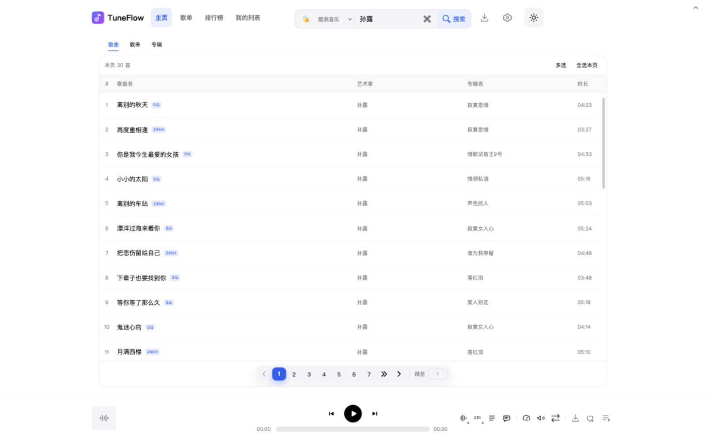
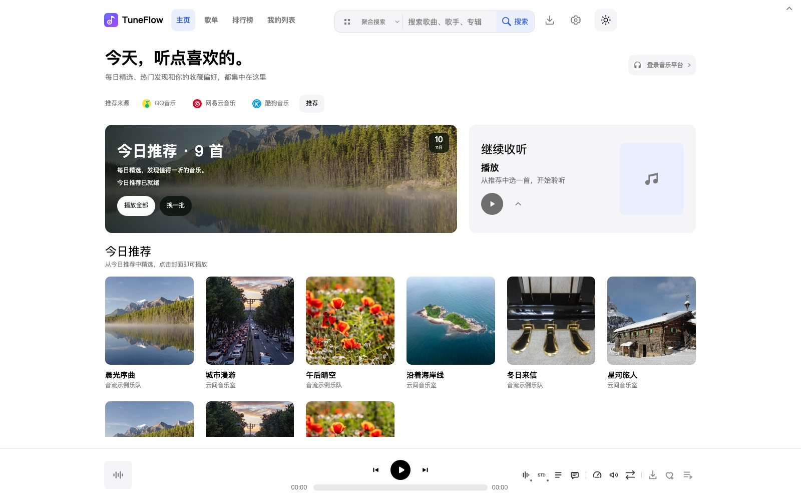
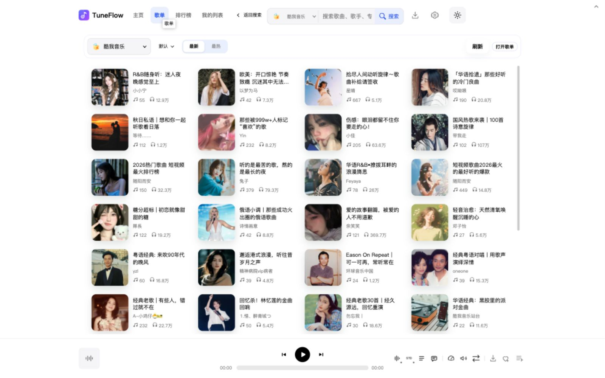
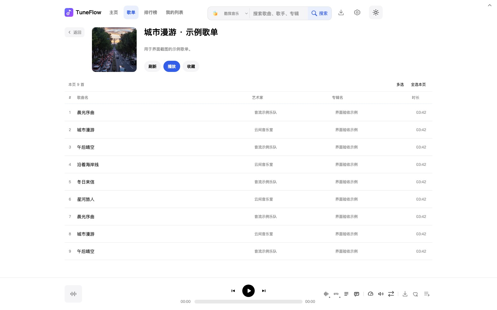
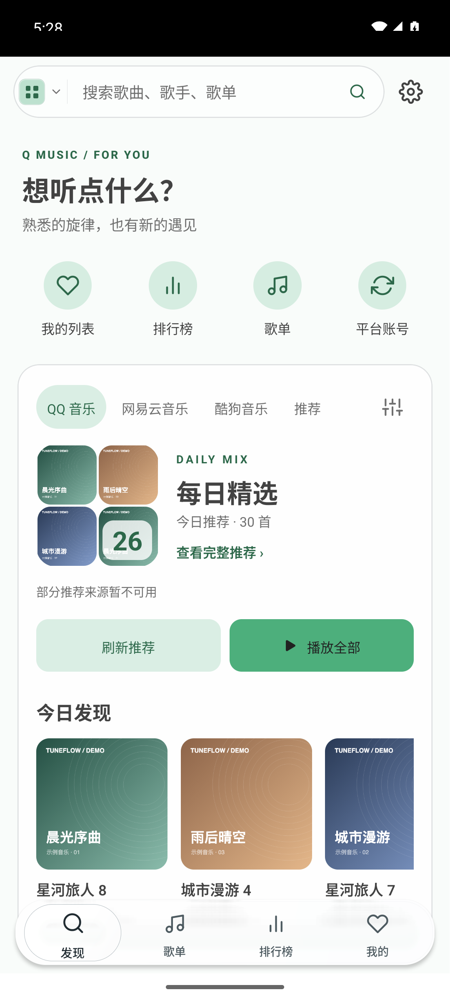
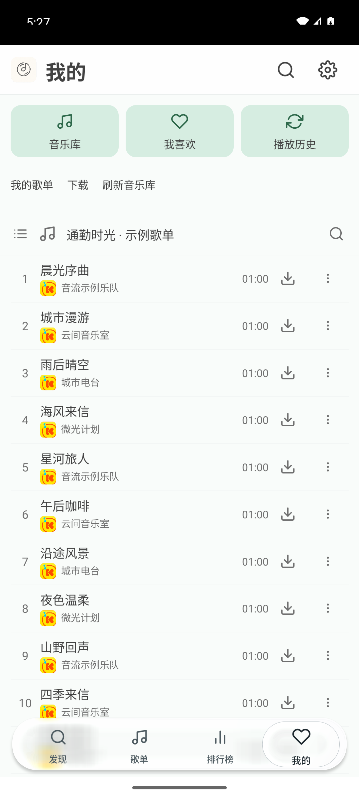

# TuneFlow · 音流

搜索想听的歌，发现新的歌单，把喜欢的音乐收藏下来。TuneFlow 支持桌面、Web 和 Android，连接同一服务后，可以在不同设备上访问自己的歌单、收藏和音乐库。

[下载安装](https://github.com/appdev/TuneFlow/releases) · [部署 Web](#部署-web) · [问题反馈](https://github.com/appdev/TuneFlow/issues)

## 找到想听的音乐

**搜索是 TuneFlow 的核心入口。** 输入歌曲、歌手或专辑名称，选择一个音乐平台搜索，也可以使用聚合搜索，在同一处查看多个平台的结果。歌曲、歌单和专辑分开展示，找到喜欢的内容后即可播放或收藏；专辑搜索的可用范围随平台而异。



## 发现下一首喜欢的歌

不知道听什么时，从首页推荐开始。浏览平台精选、查看完整歌单，或换一批内容继续探索。登录受支持的音乐平台后，还可以使用相应的账号推荐。



歌单广场可以按平台、分类和排序浏览，排行榜则提供另一种发现热门音乐的方式。



## 把喜欢的音乐整理在一起

收藏歌曲、自建歌单、导入受支持的平台歌单，在“我的列表”集中整理。查看歌单时，可以播放全部、选择单曲，或把歌曲加入播放队列。



## 手机上也能继续听

Android 客户端提供推荐、搜索、歌单、收藏和播放历史入口。连接同一服务后，可以在手机上访问电脑整理的歌单和音乐库。

<p align="center">
  
  
</p>

以上为 2026-10-26 截取的 Android 历史预览界面，使用示例数据，不代表当前最新版外观。[截图版本与来源](docs/images/README.md)。

## 日常听歌需要的功能

| 功能 | 可以做什么 |
| --- | --- |
| 搜索与发现 | 聚合搜索、平台搜索、首页推荐、歌单分类和排行榜 |
| 歌单与收藏 | 收藏歌曲、创建歌单、导入歌单，集中整理喜欢的音乐 |
| 播放与歌词 | 查看歌词、管理播放队列，选择可用音质、播放速度和循环方式 |
| 下载与音乐库 | 管理下载任务，完成的音乐进入音乐库；可开启“边听边存” |
| 多设备访问 | 电脑整理歌单，手机或浏览器访问同一份歌单、收藏与播放历史 |
| 外观偏好 | 浅色、深色与跟随系统，按设备保留外观和音量等偏好 |

下载任务记录与音乐文件分别管理，移除任务记录不会删除已保存的音乐。音乐库指服务管理的音乐目录；外观、音量、音频输出和临时播放队列等偏好按设备保存。

音乐内容、音质、歌词及播放可用性取决于所选平台、已配置音源和网络。应用不附带可用音源或第三方音乐资源，请尊重版权并支持正版。

## 开始使用

### 选择你的设备

| 平台 | 使用方式 |
| --- | --- |
| Web | 打开已部署的服务地址，无需安装客户端 |
| macOS / Windows / Linux | 从 [Releases](https://github.com/appdev/TuneFlow/releases) 下载对应系统和架构的桌面安装包，连接服务 |
| Android | 下载对应版本的 arm64-v8a APK；不确定架构时选择 universal 通用版，连接同一服务 |

桌面、Web 与 Android 连接同一服务后共享音乐数据及平台账号。桌面歌词、全局快捷键、官方授权等能力因平台而异，详见[桌面说明](apps/player/README.md)、[Web 说明](apps/service/docs/qmusic-web.md)和 [Android 说明](apps/android/README.md)。

### 部署 Web

可以在自己的电脑、NAS 或服务器上部署。使用 Docker 新建服务：

```sh
mkdir -p ./music
sudo chown -R 1000:1000 ./music
docker run -d \
  --name tuneflow-server \
  --init --restart unless-stopped \
  -p 3124:3124 \
  -v "$PWD/music:/music" \
  -v tuneflow-config:/config \
  apkdv/tuneflow-server:latest
```

打开 **`http://服务器IP:3124`** 即可使用。镜像也可指定版本；`2.13.12` 起无需访问密码，旧版 `2.13.11` 仍使用访问密码。服务访问范围由部署者自行管理。

使用 NAS 或 Docker 管理面板时，填写以下配置：

| 配置项 | 填写内容 |
| --- | --- |
| 镜像 | [`apkdv/tuneflow-server:latest`](https://hub.docker.com/r/apkdv/tuneflow-server) |
| 端口（TCP） | 主机 `3124` → 容器 `3124`；主机端口可自行调整 |
| 配置存储（读写） | 命名卷或主机配置目录 → `/config` |
| 音乐存储（读写） | 主机音乐目录 → `/music`；允许 UID/GID `1000:1000` 写入 |
| 重启策略 | `unless-stopped` |

**升级时保留数据：** `/config` 保存配置和账号状态，`/music` 保存音乐文件。先备份，再拉取镜像并重新创建容器，复用原有挂载；不要执行 `docker compose down -v`。完整步骤见[部署与备份说明](apps/service/docs/server-web.md#docker)。

### 下载与更新

客户端安装包统一在 [TuneFlow Releases](https://github.com/appdev/TuneFlow/releases) 发布，选择对应系统、架构和版本，并按发布说明核对 SHA256。Web 随服务镜像提供，无需单独下载。

旧版用户按发布说明手动下载新版覆盖安装，保留原应用身份和数据目录，无需卸载；不同通道的安装包不要混用。版本差异、签名和实机验证范围以对应 Release 说明为准。

## 关于截图

Web 图片于 **2026-11-03** 从当前工作区运行界面截取，包含本次部署的布局和下拉框修正，展示平台公开推荐、搜索与歌单内容。截图不代表应用提供音乐资源，也不代表各平台登录或播放均已验收。[截图版本与来源](docs/images/README.md)。

## 开发与贡献

源码、构建和发布信息见[仓库结构](docs/monorepo.md)、[服务端](apps/service/README.md)、[桌面/Web](apps/player/README.md)、[Android](apps/android/README.md)及[发布流程](docs/release-readiness.md)。当前维护桌面、Web、Android 及共用服务；Flutter 客户端已弃用。

欢迎通过 [Issues](https://github.com/appdev/TuneFlow/issues) / [Pull requests](https://github.com/appdev/TuneFlow/pulls) 反馈问题或贡献改进。请提供版本、平台和复现步骤，勿提交账号凭证、签名密钥或用户数据。

## 上游与许可

TuneFlow 基于 [LX Music Desktop](https://github.com/lyswhut/lx-music-desktop)、[LX Music Mobile](https://github.com/lyswhut/lx-music-mobile) 与 [Q-music](https://github.com/Nshpiter/Q-music) 修改，是独立衍生项目，并非上游官方版本。

许可与归属见 [LICENSE](LICENSE)、[NOTICE](NOTICE)、[桌面 NOTICE](apps/player/NOTICE)、[Android NOTICE](apps/android/NOTICE)；原有[项目协议与免责声明](apps/service/README.md#project-agreement)保留。第三方音乐、歌词和封面版权归原权利人所有。
