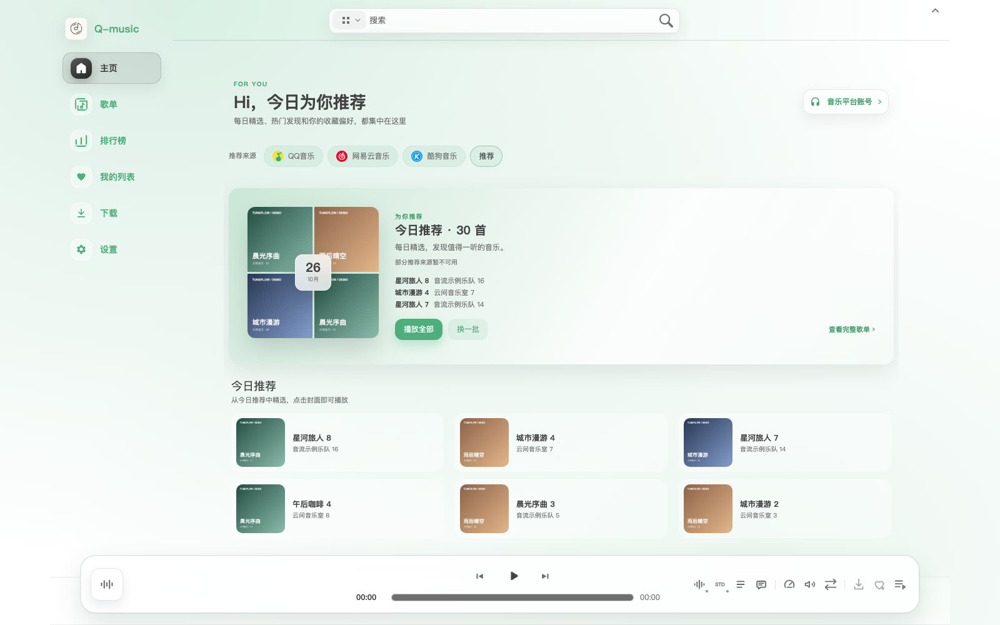
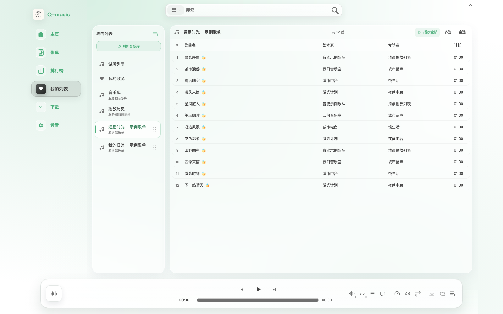
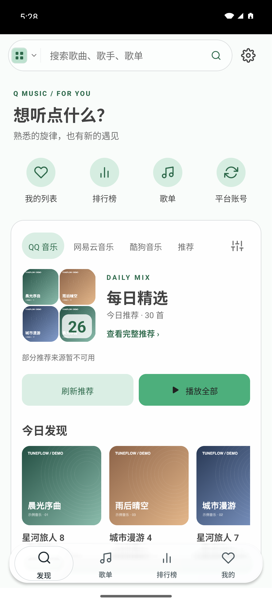
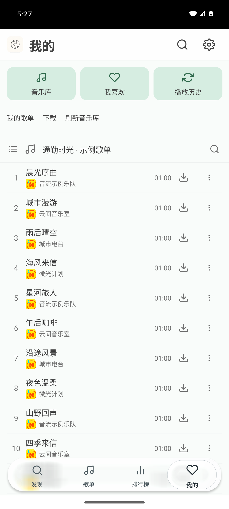

# TuneFlow · 音流

可自行部署的多端音乐应用。一个服务管理音乐库、歌单、收藏、播放历史、音源和下载，桌面、Web 与 Android 提供统一的音乐体验。

[客户端下载安装](https://github.com/appdev/TuneFlow/releases) · [服务端镜像](https://hub.docker.com/r/apkdv/tuneflow-server) · [问题反馈](https://github.com/appdev/TuneFlow/issues) · [单仓库与发布说明](docs/monorepo.md)

## 在自己的音乐空间里听歌

TuneFlow 把音乐整理和日常收听放在一起：在家中的电脑、NAS 或服务器上部署一套服务，通过浏览器直接访问，也可以连接桌面和 Android 客户端。歌单、收藏、播放历史与音乐库由服务保存，换一台设备仍能找到自己的音乐。

### 从推荐开始，也能直接找到想听的歌

首页集中展示平台精选、可用的账号推荐和今日发现，支持查看完整歌单、播放全部及换一批。没有登录账号时也可以浏览公开精选，平台内容暂时不可用时回退到通用推荐。普通页面切换复用已加载内容，减少重复等待。

想听某首歌时，可使用搜索、排行榜和歌单广场继续探索；收藏、自建歌单与已导入的平台歌单集中在“我的列表”，不必在不同工作区之间来回切换。

### 一份音乐库，电脑和手机一起使用

音乐文件放在服务管理的目录中，桌面、Web 和 Android 连接同一服务后使用同一份音乐库。你可以在电脑上整理歌单，再从手机打开；也可以不安装客户端，直接在浏览器中管理和收听。

共享的是音乐数据与服务设置，外观、音量、音频输出和临时播放队列仍按设备保存，适合不同设备各自使用。平台账号的授权方式与原生能力依对应客户端实现，不把数据共享等同于自动完成另一台设备的登录。

### 把喜欢的音乐留下来

下载任务由服务执行，完成后自动进入音乐库。除了手动选择音质下载，也可开启“边听边存”，在歌曲实际开始播放后自动保存可用音频。任务记录与音乐文件分别管理，移除记录不会误删已经下载的音乐。

播放统一经过服务解析；遇到可恢复的解析失败，可以按已配置规则继续尝试其他平台。可用音质和播放结果取决于音源、平台内容及网络，应用不附带可用音源或第三方音乐资源。

### 适合这些使用方式

| 使用方式 | 体验 |
| --- | --- |
| 家庭或个人音乐库 | 在自己的存储上管理音乐、歌单与下载，集中备份 |
| 多设备日常听歌 | 电脑整理歌单，手机或浏览器继续访问同一份数据 |
| 浏览器轻量访问 | 无需安装桌面应用，打开服务地址即可使用主要功能 |
| 希望自行掌握部署 | 自行选择服务地址、存储位置、音源和升级时机 |

## 界面预览

### Web：首页与推荐



### Web：统一歌单列表



### Android：随身访问同一份音乐

<p align="center">
  
  
</p>

截图来自实际运行的 Web 和 Android 客户端，使用隔离的示例数据，不包含私人账号或歌单。界面保留 Q-music 兼容名称，具体版本与截图来源见[截图说明](docs/images/README.md)；展示内容不代表应用默认提供音源或音乐资源。

## 产品组成

| 组成 | 职责 | 源码与说明 |
| --- | --- | --- |
| Server | Node.js 服务、SQLite、音乐库、下载、音源解析与平台自动切换，提供 `/api/v1/` | [apps/service](apps/service/README.md) |
| 桌面客户端 | macOS、Windows、Linux；Electron + Vue | [apps/player](apps/player/README.md) |
| Web | 复用桌面的 Vue 页面，由同一个 Server 提供；Docker 默认界面 | [Web 构建与能力](apps/service/docs/qmusic-web.md) |
| Android | React Native 客户端，连接同一 Server | [apps/android](apps/android/README.md) |
| 共享业务 | API、数据契约与安全地址规则；下载、推荐、歌单等跨端业务 | [service-client](packages/service-client)、[music-core](packages/music-core) |

当前仅维护桌面、Web 和 Android 客户端，以及它们共用的服务端与共享业务包。客户端源码统一在 **appdev/TuneFlow** 维护，各端保留独立依赖、构建和发布流程。

**Flutter 客户端已弃用，不再维护。** 后续功能、文案、链接修复、验证、构建和发布均不再覆盖 Flutter。

## 主要功能

- 音乐搜索、歌单、排行榜、平台精选与个人推荐；平台内容不可用时回退到通用推荐。
- 歌单、收藏、历史与音乐库由服务统一管理，连接同一服务的设备使用同一份数据。
- 播放通过服务解析音源；可恢复的解析失败可继续切换平台，取消与安全拦截不会被回退绕过。
- 下载任务、边听边存与音质选择统一管理；完成的文件进入音乐库，移除任务记录与删除音乐文件是不同操作。
- 首页缓存、主题、歌词和播放队列；外观、音量、输出设备等偏好按客户端保存。

“音乐库”指服务所管理的音乐目录。桌面、Web 与 Android 默认提供相同业务功能；官方授权、桌面歌词、全局快捷键等能力受平台限制，具体边界见各端说明。

## 安装与使用

### 部署服务与 Web

镜像：[`apkdv/tuneflow-server:latest`](https://hub.docker.com/r/apkdv/tuneflow-server)，也可将 `latest` 换成指定版本。`2.13.12` 起无需访问密码；旧版 `2.13.11` 仍使用访问密码。

#### 使用 docker run

新部署时执行：

```sh
mkdir -p ./music
sudo chown -R 1000:1000 ./music
docker run -d \
  --name tuneflow-server \
  --init --restart unless-stopped \
  -p 3124:3124 \
  -v "$PWD/music:/music" \
  -v tuneflow-config:/config \
  apkdv/tuneflow-server:latest
```

打开 **`http://服务器IP:3124`** 即可使用，无需设置访问密码。桌面和 Android 连接同一服务后共享平台账号。

#### 使用 NAS 或 Docker 管理面板

飞牛等管理面板中，创建容器时按下表填写并启动即可：

| 配置项 | 填写内容 |
| --- | --- |
| 镜像 | `apkdv/tuneflow-server:latest` |
| 端口（TCP） | 主机 `3124` → 容器 `3124` |
| 配置挂载（读写） | 命名卷或主机配置目录 → `/config` |
| 音乐挂载（读写） | 主机音乐目录 → `/music`；允许 UID/GID `1000:1000` 写入 |
| 重启策略 | `unless-stopped`（除非手动停止，否则自动重启） |

主机端口可以修改；例如改为 `3125`，就访问 `http://服务器IP:3125`。

#### 数据与升级

- **数据保存**：`/config` 保存配置与账号状态，`/music` 保存音乐文件。
- **升级**：备份上述数据，拉取新镜像并重新创建容器，保留原挂载；不要执行 `docker compose down -v`。

无需配置访问密码、可信域名或代理 IP。旧版账号数据会自动迁移，保留原 `/config` 挂载即可。服务访问权限由部署者自行管理；Compose 和备份步骤见[详细部署文档](apps/service/docs/server-web.md#docker)。

### 安装客户端

从 [客户端 Releases](https://github.com/appdev/TuneFlow/releases) 选择与系统和架构匹配的附件：

| 平台 | 兼容通道附件 |
| --- | --- |
| macOS | `TuneFlow-<version>-mac-arm64.zip` / `mac-x64.zip` |
| Windows | `TuneFlow-<version>-win-x64.zip` / `win-arm64.zip` |
| Linux | `TuneFlow-<version>-linux-x64.tar.gz` / `linux-arm64.tar.gz` |
| Android | `TuneFlow-Android-<version>-arm64-v8a.apk` / `universal.apk`；不确定架构时选择 universal 通用版 |

Web 随 Docker 镜像提供，后续不再单独发布 Web 资源包；源码构建与本地开发入口保留。已发布版本的附件保持不变。

应用与安装包统一使用 **TuneFlow** 名称，客户端安装包发布于 **appdev/TuneFlow**，使用 `TuneFlow-v<version>` 标签；Docker 镜像发布到 Docker Hub。Android 只提供 arm64-v8a 和 universal 通用版，其他架构使用通用版。客户端包含预览版本，请阅读发布说明并核对 SHA256。旧版 Android 的下载逻辑使用历史文件名，升级到 0.4.27 请手动下载新版覆盖安装一次；保留原应用 ID、签名和数据目录，无需卸载。

后续版本通过 [统一发布 Actions](.github/workflows/release.yml) 一起发布服务镜像、桌面和 Android：三端使用同一版本号、同一冻结源码，所有构建通过后才发布。Docker 保留内置 Web，不发布独立 Web 包。独立客户端和 Docker 工作流仅用于构建检查；具体版本准备、标签、试构建和失败恢复见[发布流程](docs/release-readiness.md#统一版本与发布操作)。

## 源码开发

以下命令均在仓库根目录执行。Server、桌面/Web 使用 Node.js 24；Android 发布环境使用 Node.js 22、JDK 21、Android SDK 36 / Build Tools 35.0.0、NDK 26.1.10909125。

各应用分别安装依赖，根目录不启用依赖提升，避免 Node、Electron 与 React Native 原生依赖相互覆盖。只安装本次需要构建的应用：

```sh
npm ci --prefix apps/service
npm ci --prefix apps/player
npm ci --prefix apps/android
```

| 根目录命令 | 产物或用途 |
| --- | --- |
| `npm run build:web:qmusic` | 共享 Vue Web，输出 `apps/service/dist/web-qmusic`；需 Player 依赖 |
| `npm run prepare:service` | 独立服务运行时，输出 `apps/service/dist/server` |
| `npm run build:service` | 兼容旧 Web 与服务运行时，**不构建共享 Vue Web** |
| `npm run build:player` | Electron 生产代码，输出 `apps/player/dist` |
| `npm run pack:player -- darwin-arm64` | 桌面预览归档；其他目标见 [桌面说明](apps/player/README.md) |
| `npm run build:android -- -PreactNativeArchitectures=arm64-v8a` | 内置 JS bundle 的独立预览 APK |

源码运行与 Docker 默认界面相同的 Web：

```sh
npm run build:web:qmusic
npm run prepare:service
TUNEFLOW_WEB_ROOT="$PWD/apps/service/dist/web-qmusic" npm run start:server
```

也可在根目录运行 `docker compose up -d --build`，使用仓库的 [Dockerfile](Dockerfile) 与 [compose.yaml](compose.yaml) 构建部署。镜像仅构建共享 Vue Web，不再提供旧 Web 或 Flutter integrated 构建选项。

## 验证与贡献

```sh
npm test
npm run test:service
npm run test:player
npm run test:android
npm run test:contract
```

按改动范围安装依赖并运行相关检查；账号真实登录需要本人完成官方授权，构建成功不等于各平台实机验收。提交问题或 PR 请使用 [TuneFlow Issues](https://github.com/appdev/TuneFlow/issues) / [Pull requests](https://github.com/appdev/TuneFlow/pulls)，附上版本、平台和复现步骤，勿提交账号凭证、签名密钥或用户数据。

## 上游与许可

TuneFlow 整合了基于 [LX Music Desktop](https://github.com/lyswhut/lx-music-desktop)、[LX Music Mobile](https://github.com/lyswhut/lx-music-mobile) 与 [Q-music](https://github.com/Nshpiter/Q-music) 的修改，是独立衍生项目，并非上游官方版本。

许可与归属见 [LICENSE](LICENSE)、[NOTICE](NOTICE)、[桌面 NOTICE](apps/player/NOTICE)、[Android NOTICE](apps/android/NOTICE)；原有[项目协议与免责声明](apps/service/README.md#project-agreement)保留。本项目不拥有第三方音乐、歌词、封面等版权数据，请尊重版权并支持正版。
